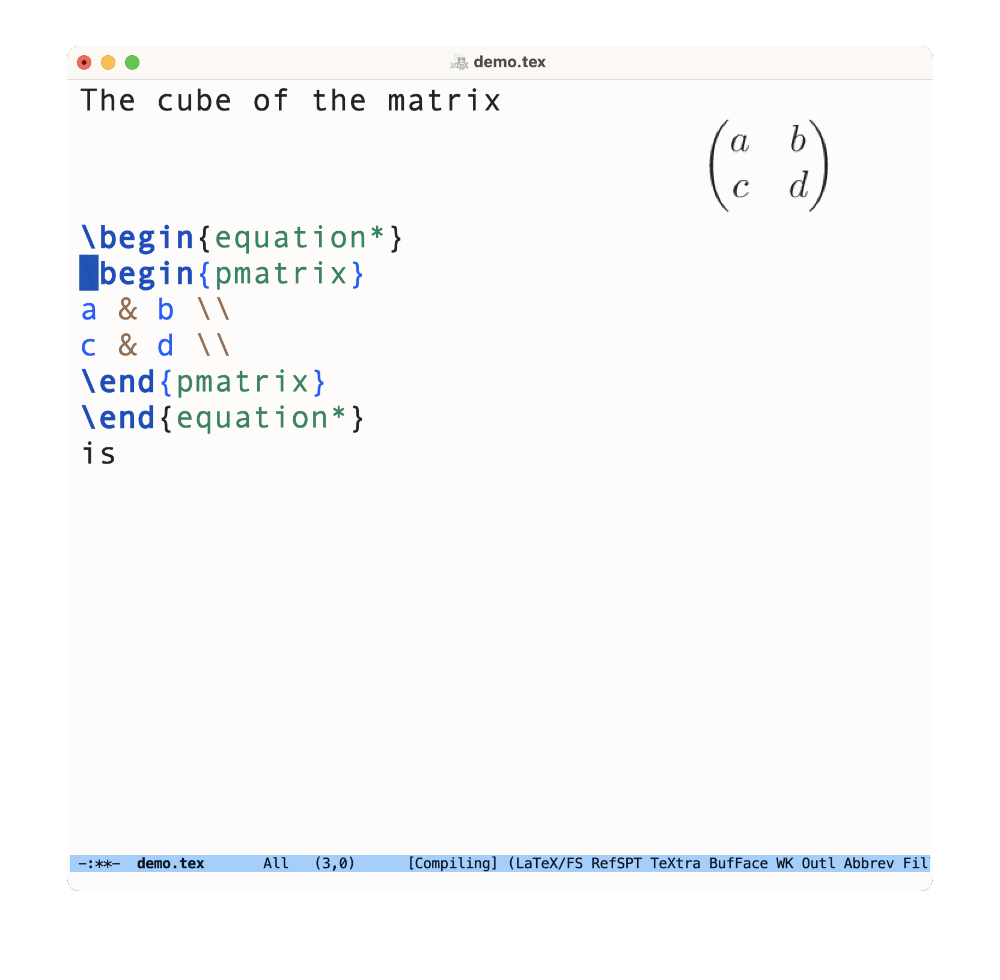
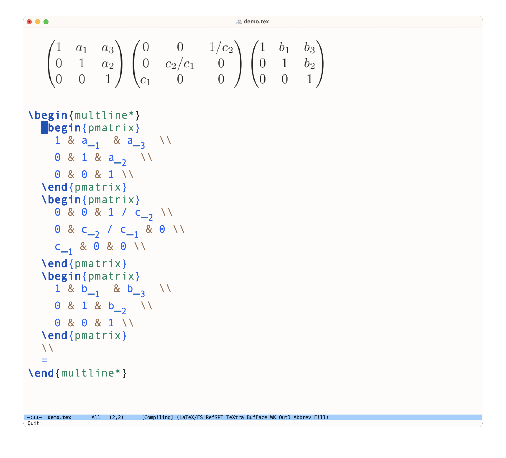

#+title: symtex.el: Evaluate SAGE code on parts of a TeX buffer
#+author: Paul Nelson

* Overview
This package makes it easy to operate symbolically on TeX code using [[https://www.sagemath.org/][SAGE]].  The main entry point is the command =symtex-dwim=, bound to =C-c v= by default.  This command evaluates a SAGE expression and stores the result of that evaluation, converted to TeX, in the [[https://www.gnu.org/software/emacs/manual/html_node/emacs/Kill-Ring.html][kill-ring]].  If we run =symtex-dwim= with an [[https://www.gnu.org/software/emacs/manual/html_node/elisp/The-Region.html][active region]], then the contents of that region are parsed are stored in the SAGE object =expr=, which we can reference in our expression.

For example, we can cube a matrix by highlighting its TeX code, running =symtex-dwim=, and entering =expr^3= in the minibuffer:

#+attr_html: :width 800px
#+attr_latex: :width 800px

(The live previewing is via the package [[https://github.com/ultronozm/preview-auto.el][preview-auto]].)

When the region is inactive, the command =symtex-dwim= behaves similarly, except that =expr= is not set to anything before our SAGE expression is evaluated.

If we run =symtex-dwim= with an [[https://www.gnu.org/software/emacs/manual/html_node/elisp/The-Region.html][active region]] and a [[https://www.emacswiki.org/emacs/PrefixArgument][prefix argument]] (=C-u C-c v= by default), then we evaluate a "default" expression, which by default is essentially =expr.expand()= (see the customization variable =symtex-expand-expression=).  Here's an example where we use this feature to multiply some matrices.

#+attr_html: :width 800px
#+attr_latex: :width 800px

A common workflow for me is to assign some of my TeX expressions to SAGE variables.  I do this by highlighting those expressions, running =symtex-dwim=, and entering, for instance, ~a = expr~, which assigns the highlighted expression to the variable =a=.  I then perform some calculations directly in the =*Sage*= buffer.  When I've produced some result that I want to put back in my TeX buffer, I call =symtex-dwim= with an inactive region.

The SAGE expressions are evaluated in an active SAGE session.

[[https://www.gnu.org/software/emacs/manual/html_mono/calc.html][Emacs Calc]] gives a built-in way to do something in the direction of this package, but sometimes one wants to use features of SAGE that are not found in Calc.  Another approach would be to use [[https://github.com/sagemath/ob-sagemath][ob-sagemath]] in an org-mode buffer, which can naturally combine SAGE code and TeX, but I often find it more convenient to work in a TeX buffer, so that I have direct access to [[https://www.gnu.org/software/auctex/manual/auctex/Installation.html#Installation][AUCTeX]] and to [[https://github.com/ultronozm/czm-tex-edit.el][packages]] [[https://github.com/ultronozm/czm-tex-fold.el][that]] [[https://github.com/ultronozm/czm-tex-jump.el][build]] [[https://github.com/ultronozm/czm-tex-ref.el][upon]] [[https://github.com/ultronozm/preview-auto.el][it]].  This approach is also collaborator-friendly, since more mathematicians are familiar with TeX than with org.

There is a related [[https://marketplace.visualstudio.com/items?itemName=OrangeX4.latex-sympy-calculator][VS Code plugin]].

* Configuration
This package requires [[https://github.com/sagemath/sage-shell-mode][sage-shell-mode]] (or [[https://codeberg.org/rahguzar/sage-mode][sage-mode]]) and [[https://github.com/ultronozm/czm-tex-util.el][czm-tex-util.el]], so install those first.

Download this repository, install using =M-x package-install-file= (or package-vc-install, straight, elpaca, ...), and add something like the following to your [[https://www.emacswiki.org/emacs/InitFile][init file]]:
#+begin_src elisp
(use-package symtex
  :bind
  (:map LaTeX-mode-map
	("C-c v" . symtex-dwim)))
#+end_src

Modify suitably, replacing =C-c v= with your preferred bind.

I use [[https://github.com/progfolio/elpaca][elpaca]], with the following in my init file:
#+begin_src elisp
(use-package symtex
  :ensure (:host github :repo "ultronozm/symtex.el" :depth nil)
  :after latex
  :bind
  (:map global-map ("C-c V" . symtex-process))
  (:map LaTeX-mode-map ("C-c v" . symtex-dwim)))
#+end_src

Before using symtex commands, you need to have a running Sage process in a buffer.  You can create this buffer in one of two ways:

1. If using sage-shell-mode: Run =M-x sage-shell:run-sage= to start a Sage process.
2. If using sage-mode: Run =M-x sage-run= to start a Sage process.

By default, symtex prefers a buffer named ~*Sage*~.  Some versions of sage-mode instead create ~*Python*~.  You do not need to rename that buffer: if there is exactly one live Sage process, symtex detects and uses it automatically.

If you have multiple Sage processes, or prefer to use a specific process buffer, customize =symtex-process-buffer=:

#+begin_src elisp
(setq symtex-process-buffer "*My-Custom-Sage-Buffer*")
#+end_src

The usual workflow is:

1. Start Sage with one of the commands above.
2. In a TeX buffer, select a math expression and run =M-x symtex-dwim= (or =C-c v= with the sample binding).  Enter a Sage expression involving =expr=, such as =factor(expr)= or =expr^3=.
3. Yank the TeX result from the kill ring with =C-y=.

With an active region, =C-u C-c v= runs =symtex-expand-expression= without prompting.  With no active region, =C-c v= evaluates the Sage expression you enter directly, which is useful for retrieving a value computed in the shared Sage session.

* Issues
- This package temporarily uses override advice while parsing to compensate for a few Emacs calc bugs related to TeX parsing.  Patches have been submitted upstream (https://lists.gnu.org/archive/html/bug-gnu-emacs/2024-01/msg01776.html, https://lists.gnu.org/archive/html/bug-gnu-emacs/2024-01/msg01777.html) that should eventually make such override advice unnecessary.
